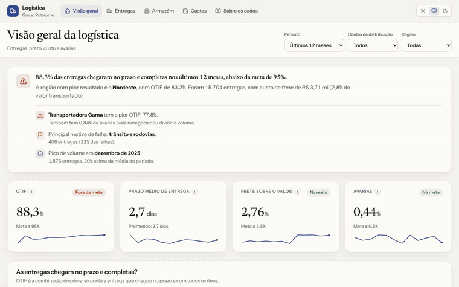
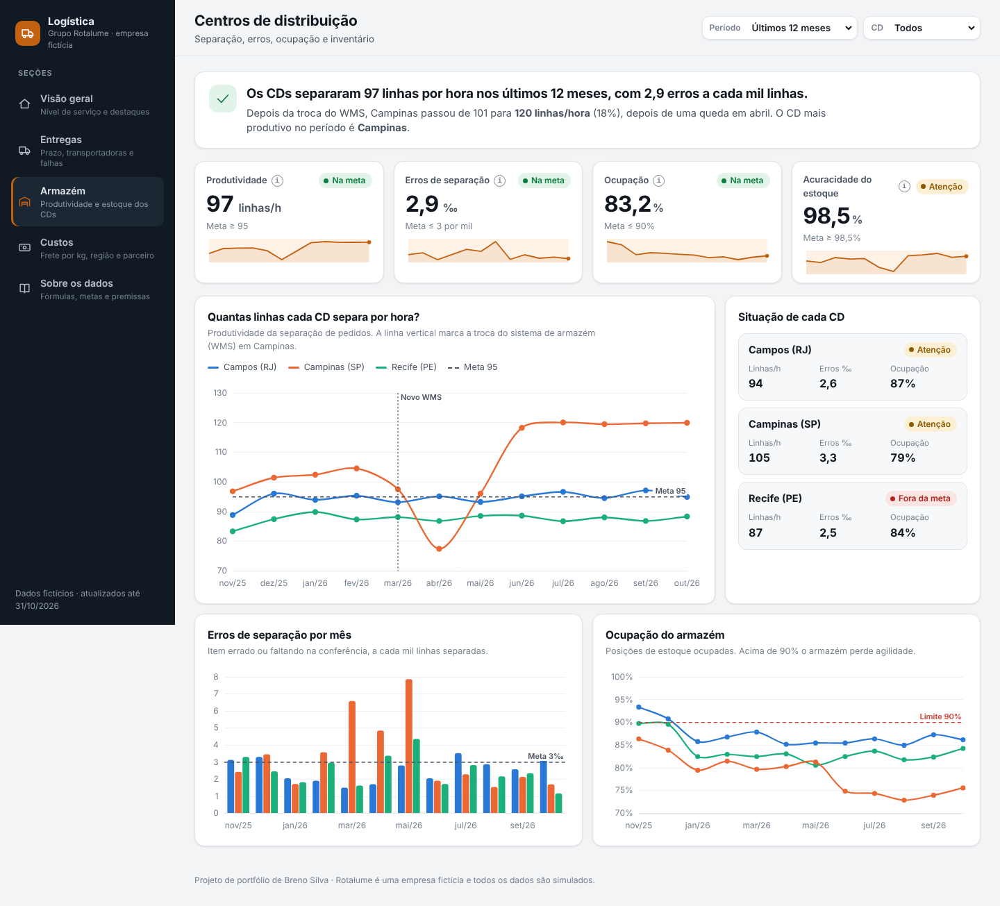
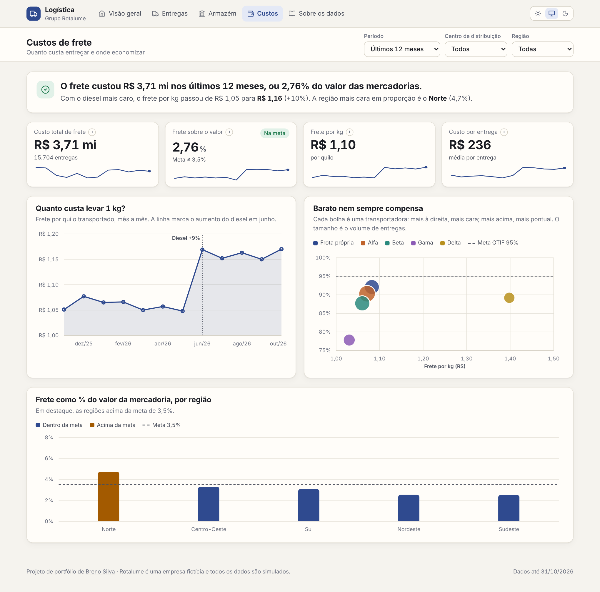

# Painel de Logística — Grupo Rotalume

[](https://github.com/Oberon-23/painel-logistica-rotalume/actions/workflows/ci.yml)

> Dashboard interativo de logística de uma empresa **fictícia** (Grupo Rotalume), em React + TypeScript, sem backend. Acompanha entregas, armazém e custos de frete entre 3 centros de distribuição e 5 transportadoras.

**[Abrir o painel →](https://painel-logistica-rotalume.vercel.app)**

## Em 30 segundos

- **Problema:** "atraso médio" esconde a entrega que chega no dia mas incompleta, e a transportadora mais barata nem sempre compensa.
- **O que fiz:** um painel de OTIF (no prazo **e** completo) com 3 centros de distribuição e 5 transportadoras, custo de frete por kg e produtividade do armazém. Cada tela abre com uma frase que diz o resultado antes dos gráficos.
- **O que ele mostra:** OTIF de 88,3% em 12 meses, abaixo da meta de 95%, com o Nordeste e a Transportadora Gama puxando o número para baixo.



## O que o painel responde

- As entregas chegam no prazo **e** completas (OTIF)?
- Qual transportadora entrega melhor, e qual é "barata mas arrisca o prazo"?
- Quanto custa entregar, por kg e por região?
- Os centros de distribuição estão produtivos (linhas separadas por hora)?

## Por que essas escolhas

- **OTIF (On Time In Full)** em vez de só "atraso médio": é o indicador padrão de supply chain porque pune tanto o atraso quanto a entrega incompleta — uma métrica mais rigorosa e mais próxima do que o cliente final sente.
- **Custo de frete por kg + produtividade por CD**: combina visão financeira com visão operacional, para não otimizar custo escondendo queda de produtividade (ou vice-versa).
- **Transportadora "barata mas não confiável" embutida nos dados**: existe de propósito um trade-off custo × confiabilidade entre as 5 transportadoras, para o painel revelar uma decisão real de negócio, não só números soltos.
- **Evento de migração de WMS em um dos CDs**: simula uma queda temporária de produtividade por causa de uma troca de sistema, testando se os indicadores separam "ruído pontual" de "tendência real".
- **React + TypeScript com dados gerados no navegador**: os dados sintéticos são criados no próprio navegador (semente fixa, reprodutível) e a aplicação é publicada como site estático, sem backend. Cada tela abre com uma manchete que diz o resultado em uma frase, antes dos gráficos.





## Dados

Todos os dados são fictícios, gerados no navegador ao carregar a página (sem chamadas externas, sem base real). Os eventos simulados (Black Friday, troca de WMS, alta do diesel) estão detalhados na aba **"Sobre os dados"** do próprio painel.

## Deploy

Aplicação estática feita com Vite. Na Vercel, basta importar o repositório: o framework é detectado sozinho (build `npm run build`, saída `dist/`). O `vercel.json` redireciona as rotas para o `index.html`, então links diretos como `/entregas` funcionam.

**Localmente:**
```bash
npm install
npm run dev       # desenvolvimento
npm run build     # gera dist/
npm test          # testes dos cálculos
```

A versão anterior, em HTML puro com Chart.js, está preservada em `legado.html`.

## Stack

React 19 + TypeScript, Vite, React Router, [Recharts](https://recharts.org/) e ícones Lucide. O tema claro/escuro usa variáveis CSS e os gráficos leem as mesmas cores, então mudam junto com o tema. Os filtros ficam salvos no navegador. A identidade visual é compartilhada com os outros painéis da Rotalume.
