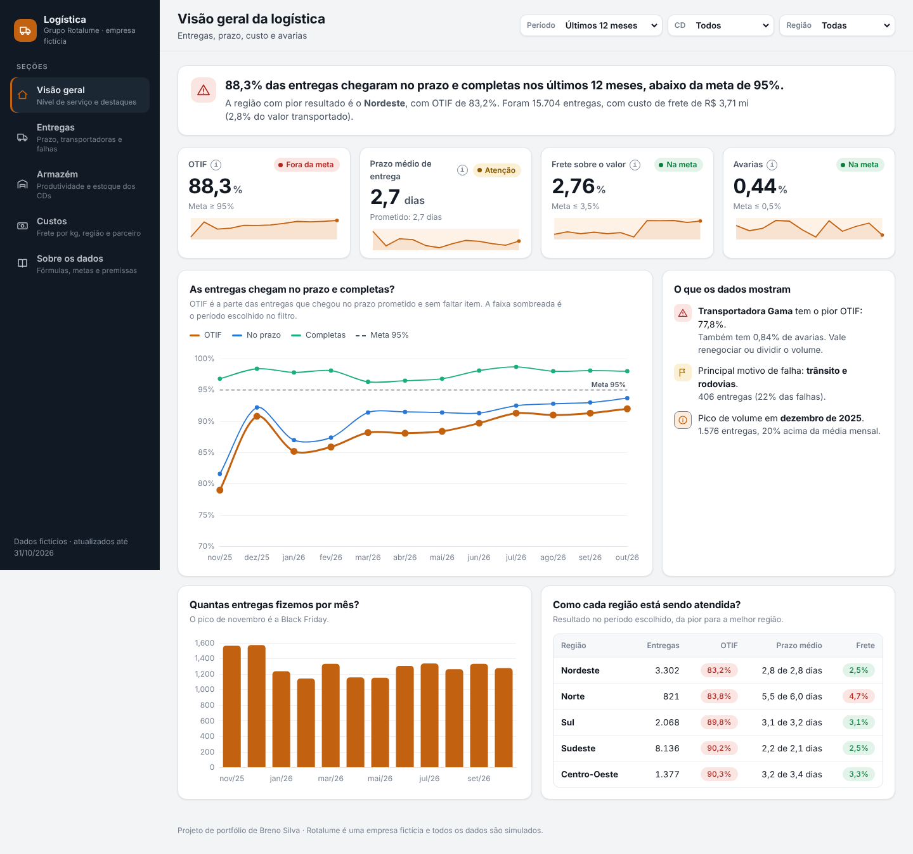

# Painel de Logística — Grupo Rotalume

> Dashboard interativo de logística de uma empresa **fictícia** (Grupo Rotalume), em HTML/CSS/JS puro, sem backend. Acompanha entregas, armazém e custos de frete entre 3 centros de distribuição e 5 transportadoras.



## O que o painel responde

- As entregas chegam no prazo **e** completas (OTIF)?
- Qual transportadora entrega melhor, e qual é "barata mas arrisca o prazo"?
- Quanto custa entregar, por kg e por região?
- Os centros de distribuição estão produtivos (linhas separadas por hora)?

## Por que essas escolhas

- **OTIF (On Time In Full)** em vez de só "atraso médio": é o indicador padrão de supply chain porque pune tanto o atraso quanto a entrega incompleta — uma métrica mais rigorosa e mais próxima do que o cliente final sente.
- **Custo de frete por kg + produtividade por CD**: combina visão financeira com visão operacional, para não otimizar custo escondendo queda de produtividade (ou vice-versa).
- **Transportadora "barata mas não confiável" embutida nos dados**: existe de propósito um trade-off custo × confiabilidade entre as 5 transportadoras, para o painel revelar uma decisão real de negócio, não só números soltos.
- **Evento de migração de WMS em um dos CDs**: simula uma queda temporária de produtividade por causa de uma troca de sistema, testando se os indicadores separam "ruído pontual" de "tendência real".
- **Arquivo único, sem build**: todo o HTML/CSS/JS está em um só arquivo (`index.html`), com dados sintéticos gerados no próprio navegador (semente fixa, reprodutível) e gráficos via Chart.js por CDN. Isso permite publicar em qualquer hospedagem estática — Vercel, GitHub Pages, Netlify — sem passo de build.

## Dados

Todos os dados são fictícios, gerados no navegador ao carregar a página (sem chamadas externas, sem base real). Os eventos simulados (Black Friday, troca de WMS, alta do diesel) estão detalhados na aba **"Sobre os dados"** do próprio painel.

## Deploy

Projeto 100% estático — basta apontar a hospedagem para a raiz do repositório.

**Vercel:**
```bash
npm i -g vercel   # se ainda não tiver
vercel --prod
```
Ou: importar o repositório direto em [vercel.com/new](https://vercel.com/new) — nenhuma configuração de build é necessária (é um `index.html` puro).

**Localmente:** abra `index.html` no navegador, ou sirva com qualquer servidor estático (`npx serve .`).

## Stack

HTML5, CSS3 (custom properties para tema claro/escuro), JavaScript (ES6+), [Chart.js 4.4.1](https://www.chartjs.org/).
